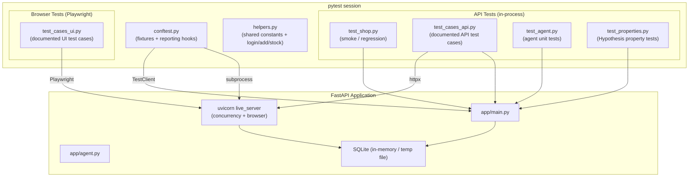

# Design Document: Test Suite for Shop-Backend

## Overview

This document describes the architecture, components, data models, and correctness properties for the comprehensive test suite that covers the Shop-Backend application.

The Shop-Backend is a FastAPI application backed by SQLite, serving a static SPA frontend and an optional AI chat agent. The test suite must cover six functional API areas (Authentication, Products, Cart, Coupons, Checkout, Orders), two cross-cutting areas (System/Reset, Security), a browser/UI layer driven by Playwright, and the Chat Agent. A subset of tests verify universal invariants using property-based testing with Hypothesis.

### Design Goals

- Every test starts from a clean, deterministic seed state via `POST /test/reset`.
- API tests run in-process using FastAPI's `TestClient` against an isolated in-memory SQLite database; they do not depend on a live server.
- Concurrency tests (checkout race conditions, cancel-once) use a real `uvicorn` process on a free port (the `live_server` fixture).
- Browser/UI tests drive a Playwright-controlled Chromium against the `live_server`.
- Property-based tests (Hypothesis) verify universal invariants about arithmetic, round-trips, and ordering without exhaustive enumeration.
- All test outcomes are captured in `test-report/results.json` and `test-report/test_cases.csv` via the existing `conftest.py` reporting hooks.

---

## Architecture

### Test Layer Diagram



### Execution Modes

| Mode | Fixture | DB | Server |
|---|---|---|---|
| In-process API | `client` | `sqlite:///tmp/test.db` (temp dir) | FastAPI TestClient |
| Live server (concurrency / browser) | `live_server` | `sqlite:///tmp/live.db` (separate temp dir) | uvicorn subprocess |
| External target | `SHOP_BASE_URL` env var | remote | already running |

The `client` fixture resets state before every test via `POST /test/reset`. The `page` fixture (Playwright) also resets state before every browser test.

---

## Components and Interfaces

### 1. `conftest.py` — Fixtures and Reporting

**Already exists.** Provides:
- `client` fixture: `TestClient` with pre-test reset. Supports `SHOP_BASE_URL` override for external targets.
- `live_server` fixture (session-scoped): uvicorn subprocess on a free port, polls `/health` for up to 30 s.
- `browser` fixture (session-scoped): Playwright Chromium instance, skips gracefully if unavailable.
- `page` fixture: per-test browser context with reset and JS-error collection.
- `pytest_runtest_makereport` hook: records pass/fail/skip per `@case` marker.
- `pytest_sessionfinish` hook: merges and writes `test-report/results.json` and `test-report/test_cases.csv`.

### 2. `helpers.py` — Shared Utilities

**Already exists.** Provides constants (`CARD`, `DECLINED`, `PASSWORD`, `SHIP`, `RESET`) and helpers (`case`, `login`, `add`, `stock`).

### 3. `test_shop.py` — Smoke / Regression

**Already exists.** Fast, broad smoke tests. Not extended in this design (they remain as-is).

### 4. `test_cases_api.py` — Documented API Test Cases

**Already exists with many cases.** Will be extended with:
- Remaining cases from Requirements 2–9, 11 not yet implemented.
- Each case uses the `@case` decorator so results appear in the CSV report.
- Concurrency cases (checkout race, cancel race) use `live_server` + `threading.Barrier`.

### 5. `test_cases_ui.py` — Documented Browser Test Cases

**Already exists with many cases.** Will be extended with remaining Requirement 10 cases not yet covered.

### 6. `test_agent.py` — Chat Agent Unit Tests

**Already exists.** Covers: not-configured status, tool dispatch, error propagation, conversation continuity, step-limit enforcement, Gemini/Anthropic format, model error codes. Will be extended with remaining Requirement 11 cases.

### 7. `test_properties.py` — Property-Based Tests (NEW)

New file implementing Hypothesis property tests for Requirement 12 and the property clauses scattered across Requirements 2–9.

**Key imports:**
```python
from hypothesis import given, settings
from hypothesis import strategies as st
```

**Strategies used:**
- `st.integers(min_value=1, max_value=30)` — valid product ids
- `st.integers(min_value=1, max_value=stock)` — valid quantities per product
- `st.text(min_size=1).filter(lambda s: s.strip())` — non-blank strings for names
- `st.emails()` or `st.from_regex(r"[a-z0-9]+@[a-z]+\.[a-z]+")` — valid email addresses
- `st.floats(min_value=0.01, max_value=999_999_999.99)` — subtotal amounts for coupon tests
- Custom `@composite` strategies for building valid cart states and registration payloads

---

## Data Models

The test suite does not define its own database models. It relies on the application's models (`app/models.py`) and the seed data (`app/seed.py`).

### Seed State (after `POST /test/reset`)

| Entity | Count | Key values |
|---|---|---|
| Products | 30 | ids 1–30; product 8 has stock 0; product 10 has stock 2 |
| Users | 2 | Alice (id 1, `alice@example.com`), Bob (id 2, `bob@example.com`) |
| Coupons | 4 | WELCOME10 (10%), FLAT200 (flat ₹200 min ₹1500), EXPIRED50 (expired), DISABLED20 (disabled) |
| Tokens | 0 | |
| Cart items | 0 | |
| Orders | 0 | |

### Test Report Schema

`test-report/results.json` — array of result objects:

```json
{
  "id": "TC-AUTH-001",
  "area": "Authentication",
  "type": "API",
  "priority": "P1",
  "title": "Login with valid credentials",
  "steps": "...",
  "expected": "...",
  "status": "Pass | Fail | Skipped | Not run | Blocked",
  "actual": "...",
  "automated_by": "test_cases_api.py::test_auth_001"
}
```

`test-report/test_cases.csv` — same data as a CSV with human-readable column headers.

### Property Test Tag Format

Each Hypothesis property test is tagged with a comment referencing the corresponding design property:

```python
# Feature: test-cases, Property N: <property_text>
```

---

## Correctness Properties

*A property is a characteristic or behavior that should hold true across all valid executions of a system — essentially, a formal statement about what the system should do. Properties serve as the bridge between human-readable specifications and machine-verifiable correctness guarantees.*

### Property 1: Product detail consistency

*For any* valid product id present in the seed catalogue, the object returned by `GET /products/{id}` has field values equal to the corresponding entry in the list returned by `GET /products`.

**Validates: Requirements 3.11, 12.1**

### Property 2: Product field invariants

*For any* product object returned by `GET /products`, `price > 0`, `price ≤ mrp`, `stock ≥ 0`, `0 ≤ rating ≤ 5`, `in_stock == (stock > 0)`, and `discount_percent == round((mrp − price) × 100 / mrp)`.

**Validates: Requirements 3.2, 3.3**

### Property 3: Cart arithmetic invariant

*For any* cart state resulting from any sequence of add, update, and remove operations, the `subtotal` returned equals the sum of `unit_price × quantity` for all lines in `items`, and each `line_total` equals `unit_price × quantity` for its line.

**Validates: Requirements 4.1, 4.16, 12.4**

### Property 4: Coupon discount invariant

*For any* valid coupon validation response, `discount ≥ 0`, `discount ≤ subtotal`, and `total == subtotal − discount`.

**Validates: Requirements 5.9, 12.5**

### Property 5: Percentage coupon floor arithmetic

*For any* percentage coupon with rate `r` and any positive integer subtotal `s`, the `discount` returned by `POST /coupons/validate` equals `s * r // 100` (integer floor division).

**Validates: Requirements 5.1**

### Property 6: Checkout and order detail agreement

*For any* successful checkout, the order object returned by `GET /orders/{id}` has `subtotal`, `discount`, `total`, `items`, and `shipping` values equal to those in the `POST /checkout` response body; additionally `total == subtotal − discount` and each `line_total == unit_price × quantity`.

**Validates: Requirements 6.1, 6.13, 12.2**

### Property 7: Stock restoration round-trip

*For any* successful checkout followed by a cancellation of the same order, the stock level of each purchased product after cancellation equals the stock level recorded immediately before the checkout was placed.

**Validates: Requirements 7.4, 7.8, 12.3**

### Property 8: Order isolation between users

*For any* two distinct authenticated users, the order list returned for user A contains no order ids belonging to user B, and user A cannot read or cancel any order belonging to user B.

**Validates: Requirements 7.1, 7.2**

### Property 9: Registration-then-login round-trip

*For any* valid registration payload (well-formed email not already registered, name with at least one non-whitespace character, password of at least 8 non-whitespace characters), logging in immediately after registration with the same email and password returns HTTP 200.

**Validates: Requirements 2.4, 12.7**

### Property 10: User response excludes password data

*For any* authenticated user, every endpoint that returns a user object (login, register, `GET /me`) includes the fields `id`, `email`, and `name`, and the response body text does not contain any key whose name contains the substring `"password"`.

**Validates: Requirements 2.1, 2.15**

### Property 11: JSON round-trip fidelity

*For any* API response body, parsing the JSON response, serializing the resulting Python object back to JSON, and parsing again produces a Python object whose field values are equal to those produced by the first parse.

**Validates: Requirements 3.16, 12.8**

---

## Error Handling

### Test Infrastructure Errors

| Scenario | Handling |
|---|---|
| Reset does not return 200 within 5 s | `assert c.post("/test/reset", ...).status_code == 200` in the `client` fixture aborts the test immediately with an `AssertionError` |
| `live_server` does not respond to `/health` within 30 s | `pytest.fail("The shop server did not start")` — dependent tests are marked as errors |
| `live_server` fails to terminate within 10 s | `proc.wait(timeout=10)` raises `subprocess.TimeoutExpired`; propagated as a fixture teardown error |
| Playwright or Chromium not installed | `pytest.skip(...)` with a descriptive reason; all browser tests get `Skipped` status; session does not fail |
| `test-report/` write failure | `OSError` propagates from `pytest_sessionfinish`; visible in the pytest summary; not suppressed |

### Test Failure Isolation

- Each API test resets state before execution; a failure in one test does not pollute the next.
- Concurrent tests use `live_server` with a separate DB file, so they never interfere with in-process tests.
- Property tests (Hypothesis) catch exceptions inside generated test cases and report them as failures with a minimal shrunk counterexample. Each property test resets state via the `client` fixture before the first iteration, and between iterations where state has been mutated (using a nested reset call or a fresh `TestClient` context).

### Application Error Contract

All 4xx/5xx responses from the application must return a JSON body containing a `"detail"` field. Tests that call error paths assert `r.json()["detail"]` is a non-empty string (Requirement 8.5).

---

## Testing Strategy

### Dual Testing Approach

The suite combines two complementary test styles:

**Example-based tests** (`test_shop.py`, `test_cases_api.py`, `test_cases_ui.py`, `test_agent.py`):
- Verify specific documented scenarios with concrete inputs.
- Cover every documented test case ID (TC-AUTH-*, TC-PROD-*, TC-CART-*, TC-COUP-*, TC-CHK-*, TC-ORD-*, TC-SYS-*, TC-SEC-*, TC-UI-*).
- Include edge cases (boundary values, wrong types, SQL injection, integer overflow).
- Include concurrency scenarios using `threading.Barrier`.
- Include browser interaction tests using Playwright.

**Property-based tests** (`test_properties.py`):
- Use [Hypothesis](https://hypothesis.readthedocs.io/) to generate many random inputs and assert universal invariants.
- Each property test runs a minimum of **100 iterations** (configured via `@settings(max_examples=100)`).
- Each test is tagged with a comment in the format: `# Feature: test-cases, Property N: <property_text>`.
- Hypothesis automatically shrinks failing examples to a minimal counterexample.

### Test Files and Coverage Map

| File | Requirements covered | Test style |
|---|---|---|
| `test_shop.py` | 1–9 (smoke) | Example |
| `test_cases_api.py` | 1–9, 11 | Example (documented, with `@case`) |
| `test_cases_ui.py` | 10 | Example (Playwright browser) |
| `test_agent.py` | 11 | Example (mock-based unit tests) |
| `test_properties.py` | 2, 3, 4, 5, 6, 7, 12 | Property (Hypothesis) |

### Property-Based Testing Library

**Library:** `hypothesis` (Python)  
**Installation:** `pip install hypothesis`

Configure each property test with `@settings(max_examples=100)` as the minimum. Critical financial invariants (cart arithmetic, coupon math, checkout totals) should use `max_examples=200`.

Tag format comment placed directly above each `@given` decorator:

```python
from hypothesis import given, settings
from hypothesis import strategies as st

# Feature: test-cases, Property 1: product detail consistency
@settings(max_examples=100)
@given(st.integers(min_value=1, max_value=30))
def test_property_1_product_detail_consistency(client, product_id):
    full_list = {p["id"]: p for p in client.get("/products").json()}
    if product_id not in full_list:
        return  # id outside seed range; skip silently
    detail = client.get(f"/products/{product_id}").json()
    assert detail == full_list[product_id]
```

Because Hypothesis tests mutate application state, each property test function must perform a reset at the start (or use database transactions / in-memory isolation) to ensure Hypothesis can run many independent iterations without state leakage.

### Concurrency Testing

Concurrency tests use `live_server` + Python `threading.Barrier` to fire requests simultaneously:

- **Checkout oversell prevention** (Requirement 6.10): 6 users each adding 1 unit of a 2-stock product, all checking out at once — exactly 2 succeed (201), rest get 409, final stock is 0.
- **Cart double-checkout prevention** (Requirement 6.11): 8 concurrent checkout requests for one user's cart — exactly 1 succeeds, rest are refused, one order created.
- **Cancel-once enforcement** (Requirement 7.6): 6 concurrent cancel requests for the same paid order — exactly 1 succeeds (200), rest get 409, stock is restored exactly once.

### Browser Testing

Browser tests require Playwright and Chromium. When unavailable, they are auto-skipped via the `browser` fixture. Tests use `data-testid` attributes exclusively for element selection to stay robust against styling changes. The `page` fixture collects JS errors and asserts none occurred after each test.

### Skipped Test Handling

When a test is skipped (e.g., Playwright not installed), the reporting hook preserves any previously recorded result for that test ID in the merged report rather than overwriting it with a skipped status. This ensures a partial run (API-only) does not erase passing browser results from a previous full run.

### Running the Suite

```bash
# All tests (requires Playwright + Chromium for UI tests)
pytest

# API + property tests only (no Playwright needed)
pytest tests/test_shop.py tests/test_cases_api.py tests/test_agent.py tests/test_properties.py

# Single non-watch run
pytest --tb=short -q

# Property tests only
pytest tests/test_properties.py -v

# UI tests only (requires live server + Playwright)
pytest tests/test_cases_ui.py -v
```
